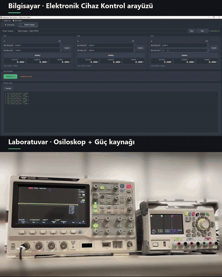
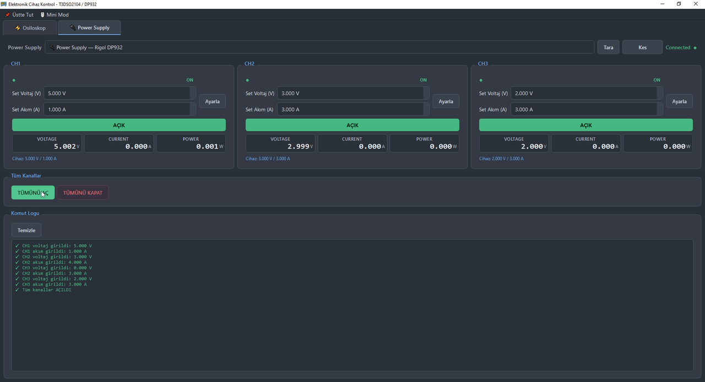
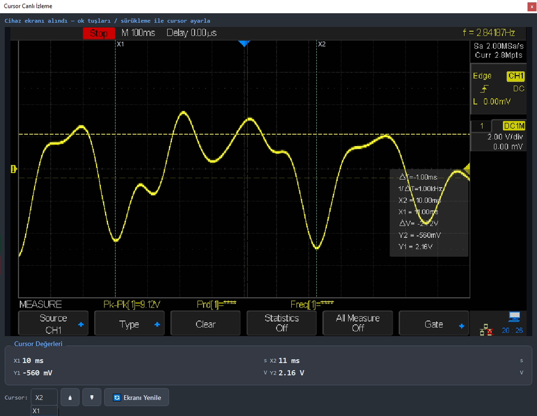
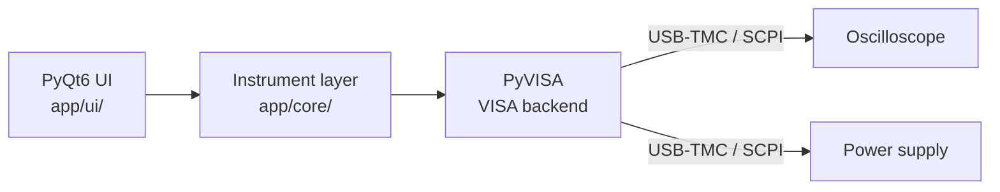

# Lab Bench Control

A Windows desktop app that controls a bench oscilloscope and a programmable power supply from one window, over SCPI / VISA.

Why: the oscilloscope and the power supply took up half of my test bench, and every setting meant reaching over to their front panels. With this app both instruments sit on the shelf above the bench and are controlled from the PC, so the bench stays free for the board under test.

<p align="center">
  
  <br>
  <sub>Top: the app. Bottom: the real instruments. "Turn all on" enables all three supply channels, then each channel is switched on and off one by one.</sub>
</p>

## Supported instruments

| Instrument | Model | Interface |
|---|---|---|
| Oscilloscope | Teledyne LeCroy T3DSO2000 series (tested on T3DSO2204) | USB-TMC, SCPI |
| Power supply | Rigol DP932 (3 channels) | USB-TMC, SCPI |

Connected instruments are recognised by their USB vendor ID. Other SCPI instruments from the same families should need only small changes in `app/core/`.

## Features

**Power supply**
- Set voltage and current limit per channel, switch outputs on and off
- Turn all channels on or off with one button
- Live voltage, current and power readback for every channel

**Oscilloscope**
- Timebase, V/div, offset, coupling, channel on/off
- Trigger level and edge; RUN / STOP / SINGLE / ARM
- Frequency, period and Vpp measurements, once or continuously (every 500 ms)
- Save the scope screen as a BMP file

**Cursor monitor**
- Pulls the scope screen into a window on the PC
- Move the X1 / X2 / Y1 / Y2 cursors with arrow keys or by dragging them on the image; values update live

**Quality of life**
- Mini mode: a small always-on-top window that shows the active supply channels
- Command log: every SCPI command sent and every reply received
- Ctrl+Alt+E shortcut to open or focus the app

<p align="center">
  
</p>
<p align="center">
  
</p>

## How it works



- **`core/visa_device.py`**: shared base class. Every read and write goes through a lock, so background threads and the UI never talk to the same instrument at the same time. If a USB session breaks (a half-finished read can lock up USB-TMC), the device is cleared and the session is reopened automatically. A global registry stops two tabs from opening the same port.
- **`core/oscilloscope.py`, `core/powersupply.py`**: instrument-specific SCPI commands behind plain Python methods (`set_voltage`, `read_current`, `set_cursor_pos`, `screenshot` ...).
- **`ui/`**: one tab per instrument. Slow operations (screen capture, continuous measurement, cursor polling) run in `QThread` workers so the window never freezes.

## Getting started

Requirements: Windows, Python 3.10+, and a VISA library (NI-VISA or Keysight IO Libraries).

```bash
pip install -r requirements.txt
python app/main.py
```

On first launch the app adds a Start Menu shortcut with the Ctrl+Alt+E hotkey.

Optional:
- `build_exe.bat` builds a Windows executable with PyInstaller (`dist\ElektronikCihazKontrol\`, needs `pip install pyinstaller`)
- `kur_kisayol.bat` adds the same shortcut to the desktop
- `kur_hotkey.bat` starts a small background hotkey listener at Windows startup, a fallback if the shortcut hotkey does not work

## Project structure

```
app/
  main.py              main window, mini mode
  core/                VISA connection and instrument command layers
  ui/                  oscilloscope tab, power supply tab, cursor monitor, styles
tools/                 small scripts used to explore instrument commands
docs/                  images used in this README
```

The user interface is in Turkish.
